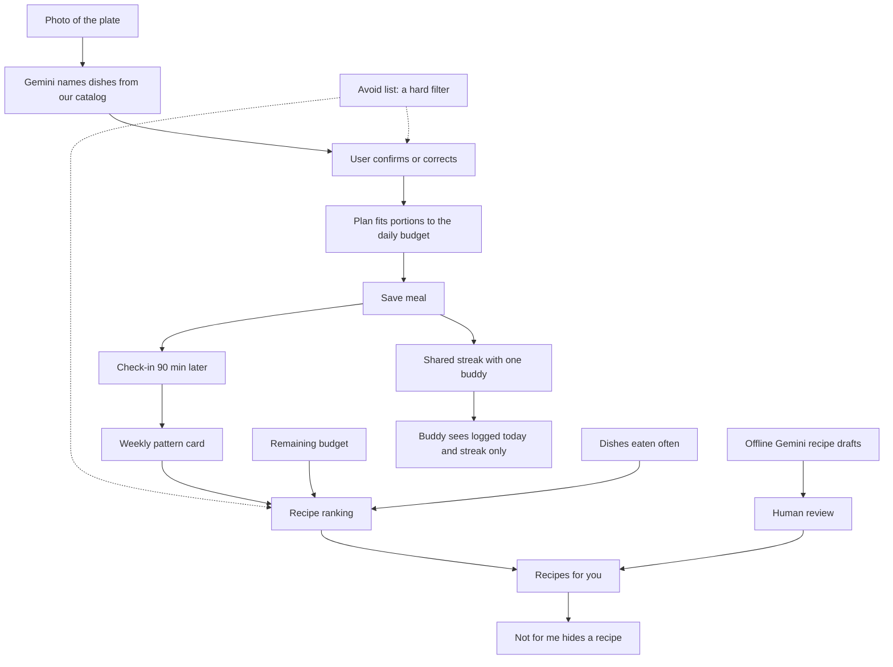

# Hissa (Portion Coach) — PRD summary

Full PRD: _add the shared PRD link here_ (source file: "Portion Coach PRD.pdf", Oct 30, 2026).

## One line

Hissa tells you how much to eat of the meal in front of you, in under 30 seconds, before you eat it.

## Why

Trackers record what you already ate. In most Pakistani homes the household cook chooses the menu, so the only decision the user controls is how much to take. Hissa is built around that decision.

**Target user:** 18 to 35, lives with family or in a hostel, eats home-cooked desi food, wants to lose or manage weight without cooking separate meals. Opens the app at the table, 2 to 3 times a day.

## Modules

| Module           | Priority    | Effort | Done means                                                            |
| ---------------- | ----------- | ------ | --------------------------------------------------------------------- |
| 1. Portion Coach | Must ship   | ~60%   | Photo to confirmed portion plan, saved to the daily log, tested e2e   |
| 2. Duo Streaks   | Should ship | ~25%   | Two real users paired, shared streak updates from real scans          |
| 3. Food and Feel | Could ship  | ~15%   | 2-tap feel check-in after a meal, one weekly insight from logged data |
| v3. Avoids and recipes | After v2 | small | Avoid list as a hard filter; reviewed recipes ranked for the user, one-tap "not for me" |

Status (2026-11-03): Module 1 is built and connected to the Expo app. Module 2 (Duo Streaks) is built end to end (API, database, app) and verified by a local two-account smoke test. Module 3 has the 90-minute check-in and a per-user evidence model; the Gemini-worded follow-up question is built (API only); the weekly pattern card is available from the API (`GET /api/feel/pattern`) but has no app screen yet; the private experiment is not built. Live status: `docs/superpowers/plans/2026-11-02-v2-status.md`.

v3 (2026-11-04, built on a branch, not run on a phone, migration not applied to the hosted project): an avoid list (beef, mutton, chicken, fish, egg, veg, or single dishes) chosen at onboarding or in Profile flags dishes at scan review ("You avoid this") and removes them from recipes. A "Recipes for you" list ranks reviewed recipes by the remaining budget, the weekly pattern and what the user eats often, with a one-tap "Not for me". Recipes are drafted once offline by Gemini and served only after a human marks them reviewed; none is reviewed yet, so none is served.

Gemini has three bounded jobs: name dishes from the catalog, word one approved check-in question, and draft recipes offline for human review. It never produces calories, counts, restrictions, diagnoses or health claims.

### 1. Portion Coach

**Status: built and connected to the Expo app.** Verified end to end on the API with real Gemini (about 2 s per scan in the last paced run: 8 of 8). A full signed-in run on a physical phone has not been done.

Photo -> Gemini picks dishes from OUR catalog (structured output with an enum plus "unknown") -> user confirms with correction chips -> nutrition per serving from our Pakistani dish catalog in the database (78 dishes, see `data-sources.md`) -> plan engine fits portions (roti, katori, plate) to the remaining daily budget -> meal saved with predicted AND confirmed values.

- Gemini never produces calorie numbers.
- Low-confidence or unknown dishes always ask the user, never silently guess.
- Budget used up: show a light plan (salad, raita, half portions), never "don't eat".
- Corrections are saved with the original prediction.
- Nutrition comes from our own catalog table, so it does not depend on a third-party nutrition API.
- A per-user daily scan cap (10) and a manual dish picker keep the flow working when the cap is hit or Gemini is down. Gemini calls use a 10 s per-attempt timeout with up to 3 attempts, because response times vary from about 1 s to over a minute.

### 2. Duo Streaks

Two users share one streak. A day counts when a person saves at least one meal. The streak grows only when both count; it resets at midnight PKT if either misses. One buddy at a time, one nudge per day. The buddy sees "logged today" and the streak, never meals, photos or calories.

### 3. Food and Feel

2-tap check-in 90 minutes after a saved meal (energy: low/okay/good, stomach: heavy/fine/light). A weekly pattern card is built by a simple rule (one answer in 60% or more of a category's check-ins, at least 3 check-ins). The card text is written by fixed templates from the observed counts, not by Gemini. The app can ask one follow-up question (`GET /api/feel/question/:mealId`): the service picks the question type and fixed options, Gemini only words it from an aggregate summary (no dish names, meals or buddy data), and a fixed question is used if the wording is missing, malformed or unsafe. After a heavy stomach and the symptom answer, the app may also ask one skippable fixed question, "Did you already feel this way before this meal?" (at most once per 14 days, never worded by Gemini); a "yes" keeps that meal out of the weekly pattern and the per-user model, so a stomach that was already unhappy is not counted against the meal's dishes. Copy says "pattern", never "cause" or "diagnosis".

## Guardrails

- Every number shown is an estimate. No medical advice.
- Nutrition numbers come from the database catalog, never from Gemini.
- English UI only for v1.

## Out of scope for v1

Training our own vision model, barcode or packaged food, workouts and wearables, groups larger than two, feeds, leaderboards, chat, meal plans, user-written recipes, Urdu UI, medical or allergy modes, payments.

## Trial success metrics

| Metric                                         | Target           |
| ---------------------------------------------- | ---------------- |
| Photo to portion plan                          | Under 10 seconds |
| Dish identified correctly on eval set (50-100) | 80% or more      |
| Items corrected per scan                       | 1 or fewer       |
| New tester completes scan flow unaided         | Under 30 seconds |
| Testers who log 5 of 7 days                    | Tracked          |

## Plan

10 days. Scan flow works end to end by day 5 (gate); if not, Modules 2 and 3 are cut down before Module 1.

## Open questions

- Expo app or responsive web first? Answered: the Expo app, which also runs on web. Google sign-in works on web and on iOS (Expo Go and builds); Android Expo Go needs a hostname the phone can resolve or a development build.
- Who owns A (AI + backend) and B (app + UX)? Answered: one teammate owns the backend and database, the other owns the app screens, landing page and visual design.
- Which 30 to 40 dishes go in the catalog? Answered: 78 dishes, 30 lab-measured (Khan 2019) and 48 from Farooq 2026; see `docs/data-sources.md`.
- Does 8x provide a template repo?
- Not in the PRD but needed: onboarding must collect sex (Mifflin-St Jeor requires it). Answered: `sex` is already a `profiles` column and the profile endpoint takes it.
- The FatSecret note (Basic forbids long-term caching, apply for Premier Free) no longer applies: FatSecret was dropped for the database catalog.

## Where Food and Feel is going (v2 design)

The approved v2 design (`docs/superpowers/specs/2026-11-02-v2-learning-loop-design.md`) keeps the rules above and adds: a per-user statistical model over whole meals (never a single dish from a mixed meal), a small question-ranker trained only on labelled synthetic data (it picks which question to ask, it does not predict food reactions), and Gemini drafting the wording of one approved question from a bounded summary, with the service validating options and falling back to a fixed question (built in Task 7). Gemini still never supplies calories, counts or health claims.
